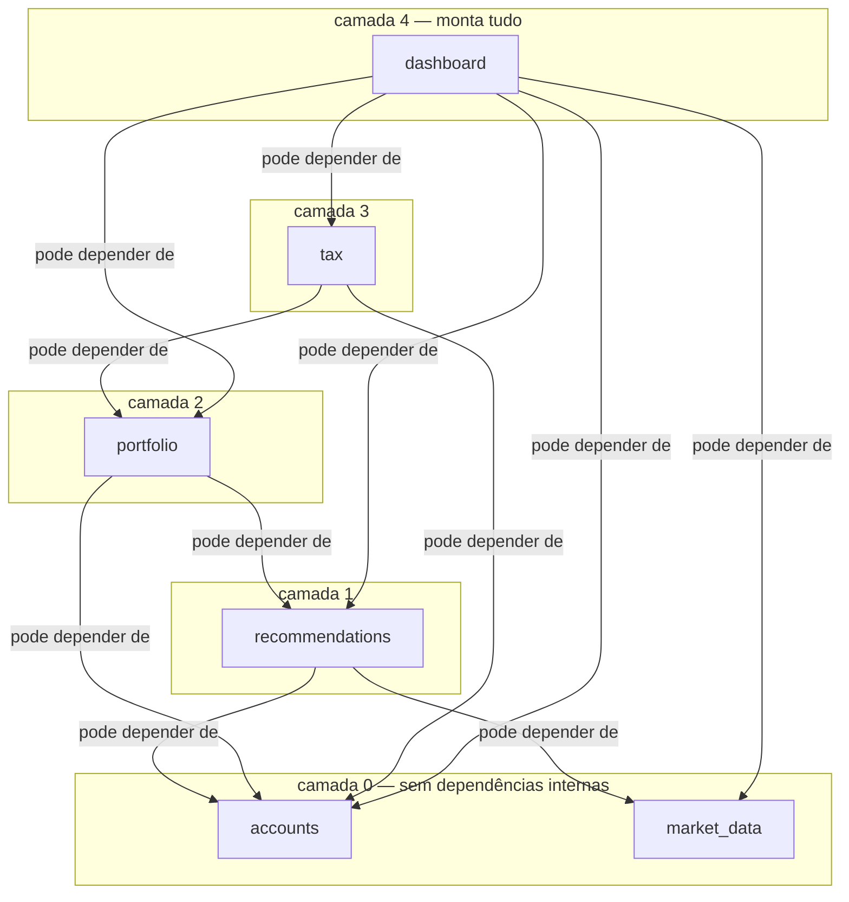

# Architecture Spine — Sistema de Recomendação de Ações para Investidores Leigos

## Design Paradigm

**Monólito Modular sobre Django (padrão MVT).** Um único projeto Django, um único deploy, um único banco de dados. Cada área de domínio vive em um app Django próprio (`accounts`, `market_data`, `recommendations`, `portfolio`, `tax`, `dashboard`), dono dos seus próprios modelos e migrations. Dentro de cada app, a camada é a padrão do Django: Model (dados), Template (renderização server-side), View (orquestração/controle). Módulos não são serviços fisicamente separados — não há rede, fila ou contrato HTTP entre eles — mas a fronteira de app é tratada como fronteira de arquitetura: comunicação entre módulos acontece por chamada de função a uma interface pública do módulo dono (tipicamente `services.py`/`selectors.py`), nunca por import direto de `models.py` de outro app para escrita, e nunca contornando a direção de dependência definida em AD-3.

Esse paradigma foi escolhido em substituição a um monólito Java cogitado anteriormente (superado) e rejeita explicitamente microsserviços e bancos NoSQL/poliglotas — ambos descartados pelo mesmo racional: complexidade operacional desnecessária para um dev solo e necessidade de consistência forte sobre dados financeiros.

## Invariants & Rules

### AD-1 — Paradigma: Monólito modular Django `[ADOPTED]`

- **Binds:** todo o sistema (`accounts`, `market_data`, `recommendations`, `portfolio`, `tax`, `dashboard`)
- **Prevents:** fragmentação em microsserviços, introdução de uma API separada + SPA, ou frameworks/linguagens divergentes por módulo.
- **Rule:** um único projeto Django (MVT, renderização server-side), um único deploy. Módulos de domínio são apps Django internos, nunca serviços de rede separados. Python é a única linguagem de aplicação.

### AD-2 — Persistência: PostgreSQL como único sistema de registro `[ADOPTED]`

- **Binds:** todos os módulos com dados próprios (`accounts`, `market_data`, `recommendations`, `portfolio`, `tax`)
- **Prevents:** um módulo escolher independentemente um banco NoSQL/poliglota, quebrando transação e consistência forte entre dados financeiros correlacionados (ex.: posição x recomendação x cálculo de IR); nem introduzir um serviço de cache externo (Redis, Memcached, etc.) pela porta dos fundos, argumentando que "cache não é banco de registro".
- **Rule:** PostgreSQL é o único banco de dados da aplicação. Todo modelo Django usa o ORM padrão sobre esse banco; nenhum módulo introduz um datastore alternativo sem nova AD. Qualquer cache no v1 é implementado sobre o próprio PostgreSQL (tabela de cache) ou em memória de processo (`LocMemCache` do Django) — nenhum serviço de cache gerenciado adicional sem nova AD.

### AD-3 — Fronteiras de módulo e direção de dependência `[ADOPTED]`

- **Binds:** `accounts`, `market_data`, `recommendations`, `portfolio`, `tax`, `dashboard`
- **Prevents:** dependência circular entre módulos e um módulo "de baixo" (ex. `market_data`) acoplar-se a um "de cima" (ex. `recommendations`), o que inviabilizaria substituir ou testar módulos isoladamente.
- **Rule:** cada módulo só pode depender de módulos permitidos pelo grafo abaixo — nunca do inverso. `market_data` é o único módulo com exceção explícita: não depende de nenhum outro módulo interno, nem mesmo `accounts`, para poder rodar de forma autônoma no job diário (AD-5). `dashboard` é o único módulo que pode depender de todos os demais, pois é a camada de montagem final (FR-3).



*(seta A → B lida como "A pode depender de B"; ausência de seta = dependência proibida)*

`tax` não importa `market_data` nem `recommendations` diretamente (ausentes do grafo acima). Quando `tax.services` precisa de cotação atual ou dados de projeção ligados a uma recomendação, o padrão é `dashboard` (a camada de orquestração) buscar esses dados nos módulos de origem e passá-los como parâmetro às funções puras de `tax.services` — nunca `tax` importando `market_data`/`recommendations` diretamente.

`accounts` é o dono da flag booleana "guia rápido já visto" (FR-3), como estado de UI persistente por usuário — mesmo não sendo dado de perfil/risco, segue o mesmo módulo por ser dado ligado 1:1 ao usuário autenticado.

### AD-4 — Camada anti-corrupção do provedor de dados de mercado `[ADOPTED]`

- **Binds:** `market_data`; indiretamente todos os módulos que precisam de cotação/fundamentos (`recommendations`, `dashboard`)
- **Prevents:** acoplamento direto de múltiplos módulos ao contrato de uma API de provedor externo específica — o que tornaria uma futura troca de provedor (risco de viabilidade real, ver Deferred) um refactor espalhado pelo sistema em vez de uma mudança isolada.
- **Rule:** somente o app `market_data` importa/chama o cliente do provedor externo de cotações e fundamentos. Todo outro módulo consome exclusivamente a interface interna de `market_data` (`services.py`), nunca a API do provedor diretamente. `market_data` também é o único ponto de cache/persistência dos dados brutos vindos do provedor. O escopo da camada anti-corrupção cobre também séries de referência macroeconômica (CDI, rentabilidade da poupança) necessárias para FR-4 — mesmo sendo uma fonte externa distinta (tipicamente Banco Central, não o provedor de cotações/fundamentos), `market_data` é o único módulo autorizado a buscar/cachear esses dados; nenhum outro módulo integra diretamente com uma fonte macroeconômica externa. Fonte exata (ex. API do Bacen) permanece em Deferred junto ao provedor de cotações/fundamentos.

### AD-5 — Trabalho em background: comando de management + agendador externo `[ADOPTED]`

- **Binds:** `market_data` (ingestão diária), `recommendations` (recálculo de status/alerta, FR-10)
- **Prevents:** introdução de infraestrutura de fila assíncrona (Celery/Redis ou equivalente) desproporcional a uma frequência de atualização de uma vez por dia.
- **Rule:** atualização de dados de mercado e verificação de alertas rodam via um Django management command, disparado por um agendador externo à aplicação (o Cron Jobs nativo da plataforma de hospedagem — AD-6). Não há fila de tarefas, worker assíncrono, nem broker de mensagens no v1. `market_data` persiste um timestamp de última atualização bem-sucedida (por ativo/série), consultável pelos módulos consumidores. Nenhum consumidor (`recommendations`, `dashboard`) trata um dado como atual sem checar esse timestamp contra o limiar de frescor (≤ 1 dia útil, PRD §10) primeiro. Cálculo de dia útil (para o limiar de frescor) é responsabilidade de `market_data`, não duplicado em outro módulo. A ingestão de dados de mercado e a verificação de alertas/status NÃO são dois Cron Jobs independentes no Render — são passos sequenciais de um único management command orquestrador (ex. `run_daily_pipeline`), que executa a ingestão de `market_data` primeiro e só invoca o recálculo de `recommendations` se a ingestão terminar com sucesso. Um único Cron Job no Render dispara esse orquestrador.

### AD-6 — Hospedagem e deploy: Render (PaaS) `[ADOPTED]`

- **Binds:** todo o sistema (deploy), `market_data`/`recommendations` (job agendado)
- **Prevents:** um pipeline de deploy customizado (containers orquestrados manualmente, IaC própria) ou escolha de agendador externo (cron de servidor próprio) incompatível com a plataforma escolhida.
- **Rule:** deploy via git-push para o Render; banco de dados é o Postgres gerenciado do Render; o job diário (AD-5) usa o recurso nativo de Cron Jobs do Render — não um cron de SO administrado à mão.

### AD-7 — Representação de valores monetários e percentuais `[ADOPTED]`

- **Binds:** todos os módulos que manipulam dinheiro ou percentual (`accounts` [poupança informada], `portfolio`, `tax`, `recommendations` [projeção])
- **Prevents:** um módulo usar `float`/tipo de ponto flutuante para dinheiro, introduzindo erro de arredondamento em cálculo fiscal ou de rentabilidade — uma classe de bug clássica e evitável em fintech.
- **Rule:** todo valor monetário ou percentual usa `Decimal` em Python e `NUMERIC` em PostgreSQL, do modelo à exibição. `float` nunca é usado para dinheiro, percentual de alocação, preço ou alíquota em nenhum módulo. Todo valor monetário final (para persistência e exibição) é normalizado com `.quantize(Decimal('0.01'), rounding=ROUND_HALF_UP)` no ponto de cálculo, dentro do módulo dono do dado — nunca arredondado ad-hoc na camada de template/exibição.

### AD-8 — Piso de proteção de dados sensíveis (v1) `[ADOPTED]`

- **Binds:** `accounts` (perfil de risco, consentimento LGPD), `portfolio` (posições), `tax` (dados usados no cálculo fiscal)
- **Prevents:** módulos implementando criptografia de campo de forma incoerente entre si (um módulo cripta, outro não) na ausência de uma decisão explícita — e também previne o oposto: alguém assumir silenciosamente que criptografia adicional existe quando não existe.
- **Rule:** a proteção de dados sensíveis em repouso e em trânsito no v1 é a fornecida pela plataforma de hospedagem (Render): criptografia em repouso do banco gerenciado e TLS em trânsito. Não há criptografia adicional em nível de campo para perfil de risco, dados financeiros ou posições no v1 — trade-off consciente e confirmado, não uma lacuna a fechar módulo por módulo. Condição de revisita em Deferred. Mensagens de log de nível INFO ou superior nunca incluem PII ou dado financeiro identificável em texto livre (e-mail, preço de posição, valor de poupança) — logs referenciam sempre `user_id`/IDs internos. Isso vale mesmo que o dado já esteja coberto pela criptografia em repouso do banco, pois logs tipicamente saem para um agregador fora desse perímetro.

### AD-9 — Renderização: templates Django server-side, sem framework JS de terceiros `[ADOPTED — herdado das spines de UX]`

- **Binds:** `dashboard` e todo template de todo módulo com superfície visível ao usuário
- **Prevents:** introdução ad-hoc de um framework JS (React/Vue/etc.) ou de um design system de terceiros (Bootstrap/MUI/shadcn) por qualquer módulo, o que fragmentaria a identidade visual "Recibo Caloroso" já fixada em `DESIGN.md`/`EXPERIENCE.md` e reintroduziria uma camada de API que o paradigma server-rendered (AD-1) elimina.
- **Rule:** toda tela é renderizada por Django Template Language (DTL), implementando o design system já especificado (`DESIGN.md`, `EXPERIENCE.md`). O acordeão da trilha de transparência usa `<details>`/`<summary>` nativos. JavaScript vanilla é usado apenas onde estritamente necessário (slider de percentual do gate de concentração, focus-trap do modal) — nunca um framework de componentes ou um bundler de aplicação SPA. Esta decisão já estava fixada a montante (UX); a arquitetura a herda, não a reabre. O focus-trap dos modais (ex. gate de concentração) usa um único módulo JS compartilhado (`static/js/focus-trap.js`), nunca reimplementado por app. Clique fora do modal do gate de concentração explicitamente NÃO fecha o modal — apenas `Esc` fecha (sem confirmar), conforme já vale para o comportamento de teclado em `EXPERIENCE.md`. A lista de elementos focáveis do trap é recalculada a cada mudança de estado interno do modal, nunca capturada uma única vez na abertura. `[ASSUMPTION]` Modo escuro no v1 segue exclusivamente a preferência do sistema operacional via `prefers-color-scheme` (CSS puro) — sem alternância manual persistida. Se um toggle manual for necessário depois, isso exigiria uma decisão de armazenamento (campo em `accounts` vs. cookie) ainda não tomada; revisitar se o produto pedir controle manual de tema.

### AD-10 — Autenticação: sessão Django nativa `[ADOPTED]`

- **Binds:** `accounts`
- **Prevents:** introdução de um provedor de autenticação de terceiros ou de autenticação por token/JWT — desnecessária e incoerente com um monólito server-rendered sem cliente de API separado; e a ausência de política mínima de senha definida, que o PRD explicitamente delega à arquitetura.
- **Rule:** autenticação usa o sistema de auth embutido do Django (sessão de servidor, hashing de senha embutido). Sem OAuth/login social, sem JWT, sem provedor de identidade externo no v1. Política mínima de senha usa os `AUTH_PASSWORD_VALIDATORS` padrão do Django (mínimo 8 caracteres, não similar a dados do usuário, não em lista de senhas comuns, não inteiramente numérica) — sem validador customizado adicional no v1.

### AD-11 — Propriedade do registro de posição (FR-13) `[ADOPTED]`

- **Binds:** `portfolio`, consumido por `tax` e `dashboard`
- **Prevents:** `recommendations` ou `tax` criarem seu próprio modelo paralelo para "posição do usuário", duplicando/divergindo o registro de entrada (preço, data, quantidade) que várias telas do Painel Único precisam referenciar de forma consistente (status FR-11, alerta FR-10, lucro líquido FR-8).
- **Rule:** o app `portfolio` é o único dono do registro que liga usuário, recomendação e dados de entrada — model `Position` com, no mínimo, referência ao usuário (`accounts`), referência à recomendação (`recommendations`), preço de entrada, data de entrada e quantidade (preço em `Decimal`/`NUMERIC`, conforme AD-7). `tax` e `dashboard` leem esse registro via a interface pública de `portfolio`; nenhum outro módulo grava nele. Sem uma `Position`, `recommendations`/`tax`/`dashboard` tratam todo número exibido como simulação ("como teria se comportado"), nunca como resultado real do usuário — conforme já fixado em `EXPERIENCE.md` ("Rotulagem: Dado Real vs. Simulado").

### AD-12 — Envelope operacional (backup, alerta de falha, ambientes) `[ADOPTED]`

- **Binds:** todos os módulos com dados próprios (`accounts`, `market_data`, `recommendations`, `portfolio`, `tax`) + AD-6 (Render)
- **Prevents:** perda de dado financeiro sem trilha de recuperação; falha silenciosa do job diário (AD-5) sem que o operador saiba; deploy contínuo direto a produção tratado como default não-decidido.
- **Rule:** (a) backup do Postgres gerenciado do Render aceito no padrão da plataforma (retenção padrão do plano contratado) — decisão consciente de usar o default do provedor, não uma política customizada de backup no v1; (b) o management command do job diário (AD-5) registra um heartbeat (ex. grava timestamp de sucesso em uma tabela simples, ou usa a notificação de falha nativa do Render Cron Jobs) para que o operador saiba se o job falhou — sem essa notificação, o job pode falhar silenciosamente; (c) não há ambiente de staging no v1 — deploy via git-push (AD-6) vai direto para produção; trade-off consciente, não uma omissão, revisitável em Deferred.

### AD-13 — Propriedade do registro de venda (FR-8) `[ADOPTED]`

- **Binds:** `portfolio` (dono), consumido por `tax`
- **Prevents:** `tax` ou outro módulo inventando seu próprio model paralelo de "venda"/"saída" — a mesma divergência que AD-11 já previne do lado da compra, agora do lado da venda, necessária para FR-8 somar "vendas registradas no mês" contra a isenção de R$20k e decidir se DARF é devido.
- **Rule:** o app `portfolio` também é dono do registro de venda/saída (ex. model `Sale`, referenciando a `Position` de origem, com data da venda, preço de venda e quantidade vendida, em `Decimal`/`NUMERIC` per AD-7). `tax` lê esse registro exclusivamente pela interface pública de `portfolio`, nunca grava nele nem cria um model paralelo.

### AD-14 — Enforcement mecânico de fronteiras de módulo `[ADOPTED]`

- **Binds:** todos os módulos
- **Prevents:** a convenção "services.py é a interface pública" e a regra de dependência de AD-3/AD-4 sendo cumpridas só de nome (lógica escondida em `models.py`, leitura direta de `models.py`/`provider.py` de outro app disfarçada de "só leitura", import cross-app dentro de uma migration de dados, ou um import "utilitário" de logging usado para furar a autonomia de `market_data`).
- **Rule:** um contrato de `import-linter` (ou equivalente) roda em CI/pre-commit e falha o build se: (a) qualquer app importar `models.py` de outro app, para leitura ou escrita, fora de `services.py`/`selectors.py` — sem exceção para "só leitura"; (b) qualquer app fora de `market_data` importar `market_data/provider.py`; (c) qualquer arquivo em `*/migrations/` de um app importar `models.py` de outro app (leitura cross-app em data migration só é permitida via a função pública `services.py` do app dono, chamada explicitamente); (d) `market_data` importar qualquer coisa de outro app interno, inclusive para logging/observabilidade — contexto de usuário em `market_data` é sempre um dado primitivo (id, string), nunca uma chamada a serviço de outro app.

### AD-15 — Posse de valor derivado e do rótulo real-vs-simulado `[ADOPTED]`

- **Binds:** `portfolio` (dono), consumido por `tax`, `recommendations`, `dashboard`
- **Prevents:** `tax` e `dashboard` calculando/cacheando "valor atual da posição" de forma independente e divergente; `tax`, `recommendations` e `dashboard` aplicando critérios diferentes para decidir se um número é "real" ou "simulado" (violando a regra de EXPERIENCE.md de que os dois rótulos nunca compartilham a mesma frase).
- **Rule:** `portfolio.services` expõe duas funções canônicas — uma para o valor atual derivado de uma `Position` (consultando `market_data` conforme o grafo de AD-3), e uma para o booleano "esta posição/venda conta como real para fins de exibição/cálculo" (rotulagem de EXPERIENCE.md). `tax`, `recommendations` e `dashboard` sempre chamam essas funções — nunca recalculam ou reimplementam o critério localmente. Qualquer cache do valor derivado vive em `portfolio`, com TTL explícito se necessário, nunca duplicado em outro módulo.

### AD-16 — Estratégia de exclusão de conta (FR-12) `[ADOPTED]`

- **Binds:** `accounts`, `portfolio`, `tax`
- **Prevents:** módulos divergindo em `on_delete` (`CASCADE` vs `PROTECT`/`SET_NULL`) para dados financeiros pessoais ligados a uma conta excluída, causando `IntegrityError` na exclusão ou registros órfãos.
- **Rule:** exclusão de conta (FR-12) é sempre `CASCADE` até o fim da árvore de FKs que remontam a `accounts.User` — nenhum `PROTECT`/`SET_NULL` em dado financeiro pessoal no v1, mesmo por prudência de auditoria. Uma eventual exigência de retenção regulatória (se a classificação CVM for revisitada — ver Deferred) é tratada como nova AD quando isso acontecer, não antecipada aqui.

## Consistency Conventions

| Concern | Convention |
| --- | --- |
| Naming (apps, models, urls, templates) | Nomes de app fixos e em `snake_case`: `accounts`, `market_data`, `recommendations`, `portfolio`, `tax`, `dashboard` (AD-3). Models em `PascalCase` (ex.: `Position`, `RiskProfile`, `Recommendation`). Templates namespaced por app (`templates/<app_label>/...`). URLs namespaced por app (`app_name` em cada `urls.py`). |
| Acesso entre módulos | Comunicação entre apps só via função pública do app dono (`services.py`/`selectors.py`); nunca import direto de `models.py` de outro app para escrita. Direção sempre conforme o grafo de AD-3. |
| Dados & formatos (dinheiro, datas, ids) | Dinheiro/percentual: `Decimal`/`NUMERIC`, nunca `float` (AD-7). Datas/horários: campos Django `DateField`/`DateTimeField`, `USE_TZ=True`, armazenados em UTC. IDs: chave primária padrão do Django (`BigAutoField`). |
| Validação & erros | Validação de formulário via Django Forms/ModelForms; erros exibidos inline junto ao campo (nunca só por cor de borda — piso de acessibilidade de `EXPERIENCE.md`). |
| Config & segredos | Configuração via variáveis de ambiente (12-factor); nenhum segredo em repositório; painel de env vars do Render é a fonte de verdade em produção. |
| Auth & sessão | Sessão de servidor do Django (AD-10); nenhum token/JWT circulando entre módulos, pois não há cliente de API separado. |
| Logging | Logging padrão do Django (`LOGGING` em `settings.py`) via `logging` da stdlib, identificando o app de origem. |
| Migrations | Uma pasta de migrations por app Django; nenhuma migration manual fora do framework de migrations do Django. |

## Stack

*Versões abaixo refletem o melhor conhecimento disponível no momento da redação deste spine (sem consulta ao vivo às páginas de release) — confirmar o pino exato (`requirements.txt`/`pyproject.toml`) antes de iniciar o build.*

| Name | Version |
| --- | --- |
| Python | 3.14 (acompanhar default do Render — hoje 3.14.3 para serviços novos; verificado ao vivo em 2026-09-07) |
| Django | 5.2 LTS — confirmado como a LTS vigente (2026-09-07); Django 6.0 é release não-LTS (não recomendado para este perfil solo/fintech), 6.2 LTS ainda não lançada |
| PostgreSQL | 18 (default atual do Render Postgres para novos bancos; verificado ao vivo em 2026-09-07; versões 13-17 ainda disponíveis se houver razão específica) |
| Render | plataforma de hospedagem (PaaS) — sem versionamento de linguagem; confirmar plano/recursos (Postgres gerenciado, Cron Jobs nativo) no provisionamento. Nota operacional: Cron Jobs do Render têm cobrança mínima de ~US$1/mês por job — considerar no orçamento, não afeta a decisão arquitetural. |

## Structural Seed

```text
{project_root}/
  config/                     # projeto Django raiz — settings, urls, wsgi/asgi
    settings.py
    urls.py
    management/commands/
      run_daily_pipeline.py     # orquestrador do Cron único do Render (AD-5): chama update_market_data,
                                 # e só então check_alerts se a ingestão tiver sucesso
  accounts/                   # auth, perfil de risco/horizonte, consentimento LGPD, flag "guia rápido já visto" (FR-1, FR-2, FR-3, FR-12)
    models.py
    services.py                # interface pública consumida por outros módulos
    views.py
    urls.py
    templates/accounts/
  market_data/                 # única porta de entrada ao provedor externo de cotações/fundamentos e às séries CDI/poupança (AD-4)
    models.py                  # cache de cotações, fundamentos e séries de referência macro (CDI/poupança); timestamp de última atualização bem-sucedida (AD-5)
    provider.py                 # cliente do provedor externo — nunca importado fora deste app
    services.py
    management/commands/
      update_market_data.py     # passo 1 do pipeline diário — chamado por run_daily_pipeline (AD-5)
  recommendations/              # motor técnico + fundamentalista, trilha de transparência (FR-5, FR-7, FR-10, FR-11)
    models.py
    engine.py
    services.py
    views.py
    templates/recommendations/
    management/commands/
      check_alerts.py            # passo 2 do pipeline diário — chamado por run_daily_pipeline só após sucesso do passo 1 (AD-5)
  portfolio/                    # gate de concentração, registro de posição e de venda (FR-6, FR-8, FR-13)
    models.py                    # Position: usuário, recomendação, preço/data/quantidade de entrada (AD-11); Sale: venda/saída referenciando a Position de origem (AD-13)
    services.py
    views.py
    templates/portfolio/
  tax/                           # cálculo de IR/ganho de capital, projeção de retorno (FR-8)
    models.py
    services.py
    views.py
  dashboard/                      # Painel Único — monta a visão de todos os módulos (FR-3)
    views.py
    templates/dashboard/
  templates/                       # base templates e partials do design system compartilhado
    base.html
  static/                           # CSS/JS do design system (DESIGN.md) — sem framework de terceiros
  manage.py
```

## Deferred

- **Provedor de dados fundamentalistas e de cotações (PRD §8, item 2).** Não decidido — risco real de viabilidade (licenciamento de redistribuição junto à B3, ausência de contrato/SLA em sites de consumo). A AD-4 (camada anti-corrupção) isola esse risco arquiteturalmente para quando a escolha acontecer, mas não a resolve. Revisitar na fase de dados/integração, antes de comprometer o roadmap de `recommendations`.
- **Limiar de "concentração excessiva" (FR-6).** PRD sugere uma faixa inicial de 20-30%, não confirmada. Não gerar história de engenharia para o gate de concentração sem esse número definido com dados reais ou produto/UX.
- **Limiar de "mudança relevante" para alerta (FR-10).** Mesma situação — dependente de dados reais disponíveis após integração com o provedor (item acima), não travável nesta arquitetura.
- **Revisão da criptografia de campo (AD-8).** O piso atual (criptografia do Render em repouso + TLS) é aceito conscientemente para o v1. Revisitar se: (a) o produto avançar para registro/certificação junto à CVM (PRD §8, item 6) e passar a ter obrigação de guarda de registro mais rígida; (b) uma auditoria/revisão de segurança formal apontar exposição concreta; ou (c) o volume de dados sensíveis armazenados crescer o suficiente para mudar o perfil de risco.
- **Autenticação de dois fatores (MFA).** Fora do v1 por decisão consciente do PRD (FR-1) apesar da conta guardar perfil de risco e dados financeiros. AD-10 não impede adicionar MFA depois (compatível com o auth nativo do Django); revisitar antes do lançamento público.
- **Classificação regulatória junto à CVM (PRD §8, item 6).** Risco de negócio aceito conscientemente pelo Daniel, não um bloqueador de engenharia. A arquitetura não resolve isso, mas não deve impedir uma extensão futura: se revisitado, a obrigação de guarda de registro pode exigir persistir histórico de recomendações passadas (hoje `recommendations` só expõe a recomendação atual — ver PRD §4.5, nota do PM) — candidato natural a uma AD futura sobre retenção histórica, não decidido aqui.
- **Compensação de prejuízos entre operações/meses (FR-8, limitação estrutural aceita).** Fora do v1. Se endereçado futuramente, exige um razão histórico entre-períodos que hoje não existe no módulo `tax` — não modelado nesta versão.
- **Ampliação de cobertura de perfil/horizonte (PRD §8, item 9).** `recommendations` no v1 só está calibrado para perfil conservador + horizonte longo prazo. Ampliar é mudança de regras de elegibilidade dentro do próprio módulo `recommendations`, não uma mudança estrutural desta arquitetura — mas as regras exatas de elegibilidade por perfil (também citadas em §8, item 5) ainda não estão definidas e não devem virar história de engenharia sem isso.
- **App mobile nativo.** Fora do escopo do v1 (web responsivo apenas). Se perseguido depois, provavelmente exige introduzir uma superfície de API (hoje inexistente, já que o v1 é puramente server-rendered) — decisão de arquitetura nova, não coberta aqui.
- **Modelo de monetização (PRD §8, item 1).** Sem peso arquitetural identificado para o v1; não bloqueia o build.
